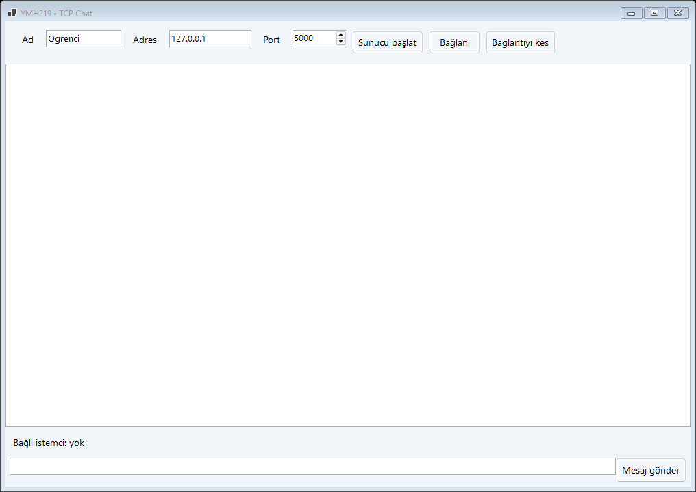
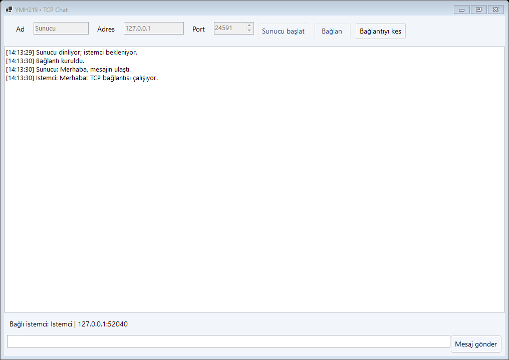

# TCP Chat

YMH219 Nesne Tabanlı Programlama ek uygulama ödevi. C# ile geliştirilen Windows Forms masaüstü uygulaması.

## Teknolojiler
Windows x64, C#, .NET 10, Windows Forms. System.Net.Sockets, async/await; ek NuGet paketi yok.

## Kurulum ve çalıştırma
1. .NET 10 SDK ve .NET 10 destekli Visual Studio (.NET masaüstü geliştirme iş yükü) kurun.
2. `ChatApp.sln` dosyasını açın, NuGet paketlerini geri yükleyin ve F5 ile çalıştırın.
3. Alternatif: bu klasörde `dotnet run --project ChatApp.csproj` çalıştırın.
4. Derleme kontrolü: `dotnet build ChatApp.csproj -c Release`.

## Temel özellikler ve kullanım
İlk örnekte kullanıcı adı girip Sunucu başlat seçin. İkinci örnekte farklı ad girip 127.0.0.1 ve aynı port ile Bağlan seçin. İki taraf da zaman damgalı mesaj gönderebilir. Sunucu bağlı istemcinin adını ve ağ adresini gösterir.

## Ekran görüntüleri

## Sınırlamalar ve geliştirme notları
Tek sunucu ve tek istemci desteklenir. Yerel ağda sunucunun yerel IP adresini kullanın; Windows güvenlik duvarı izni gerekebilir. Şifreleme yoktur; ders içi yerel ağ kullanımı içindir. Bağlantı kesildikten sonra yeniden sunucu başlatılabilir.

Arayüz MainForm, başlangıç Program, ortak görsel yardımcılar Ui sınıfındadır. Formların Dispose metotları kullanılan kaynakları temizler.

## Öğrenci bilgileri
- Ad soyad: **Talha Nuri Önder**
- Öğrenci numarası: **210541054**
